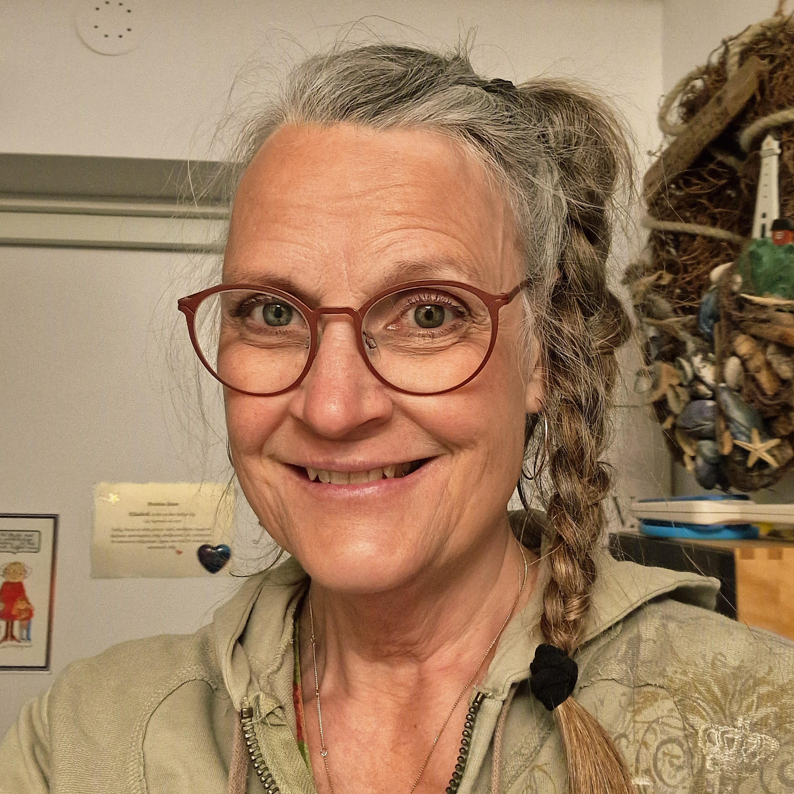
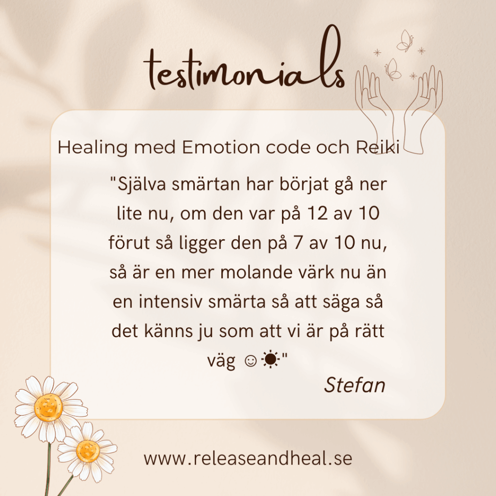
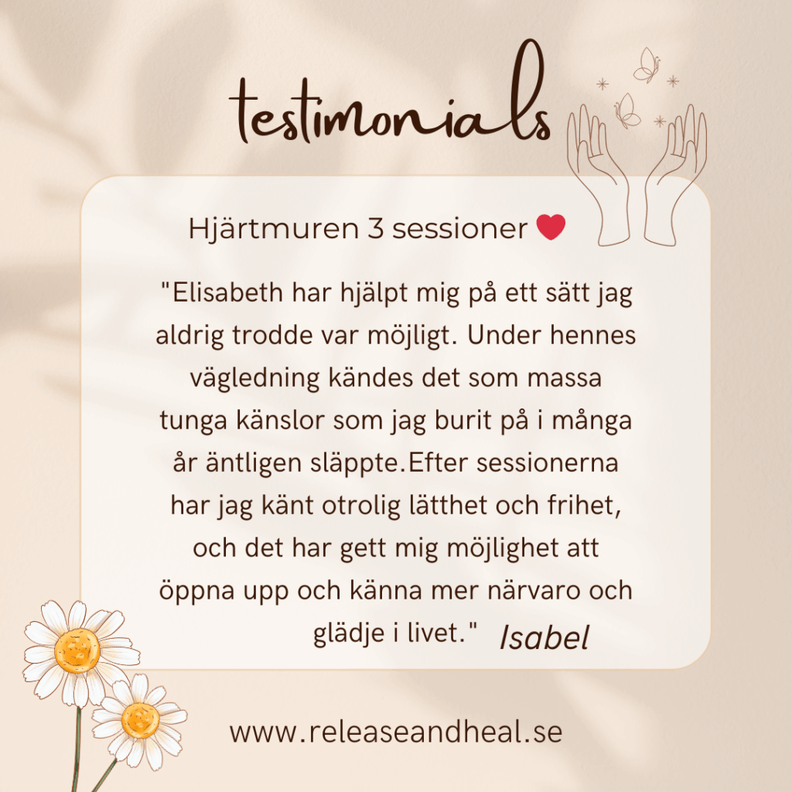
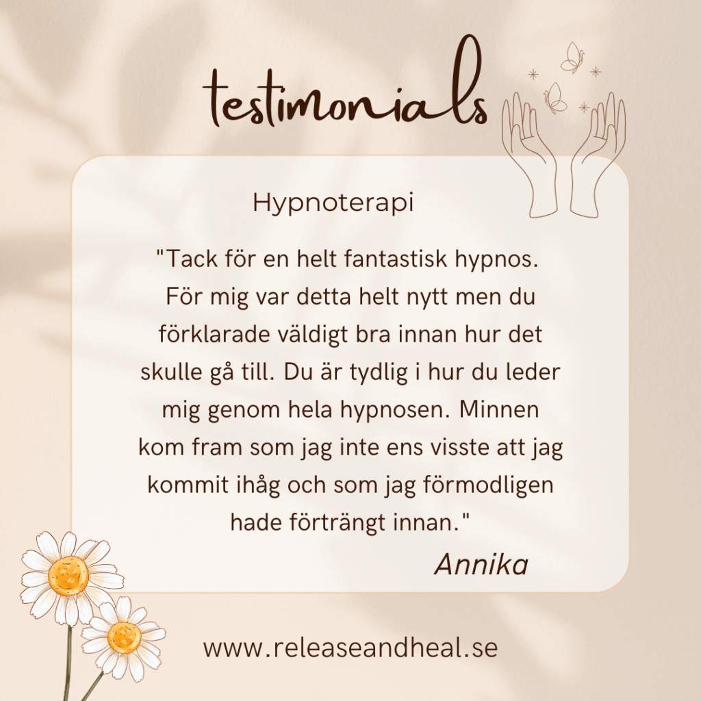
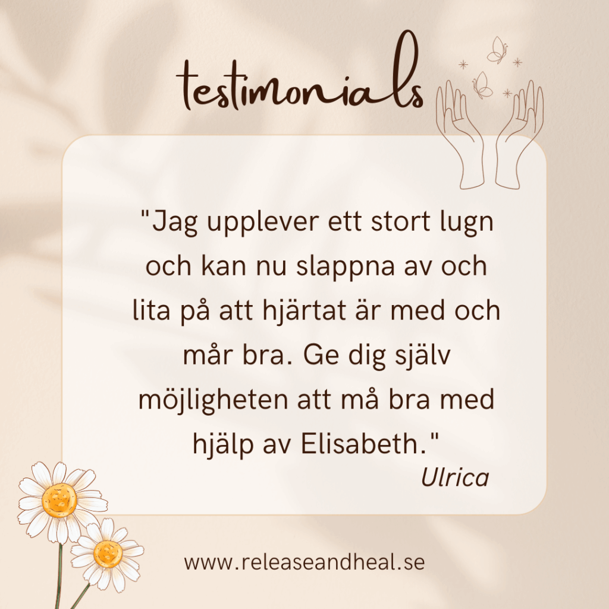
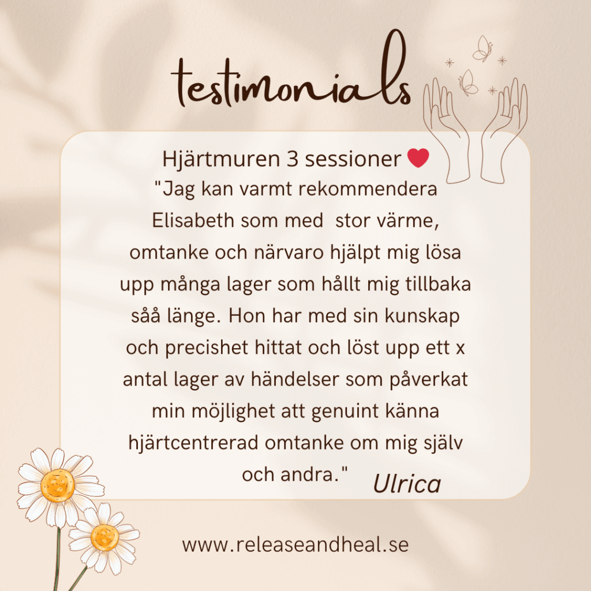
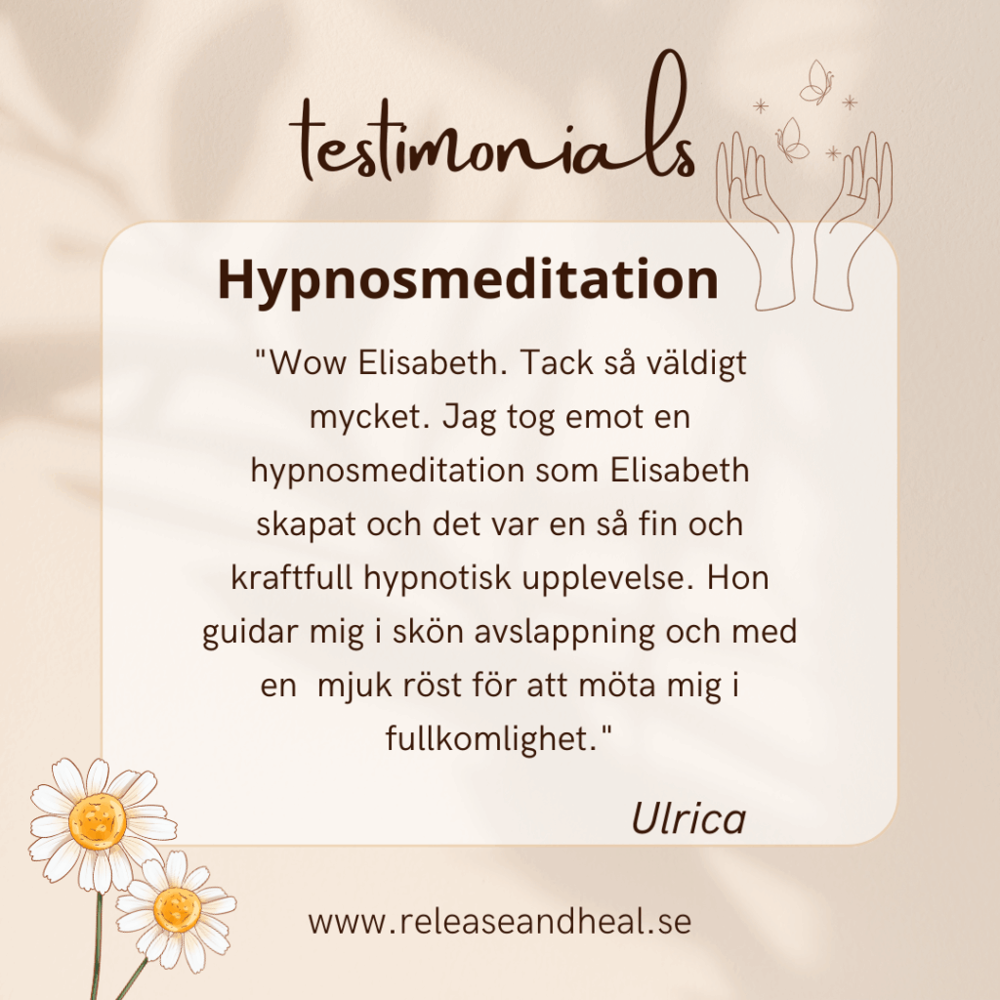
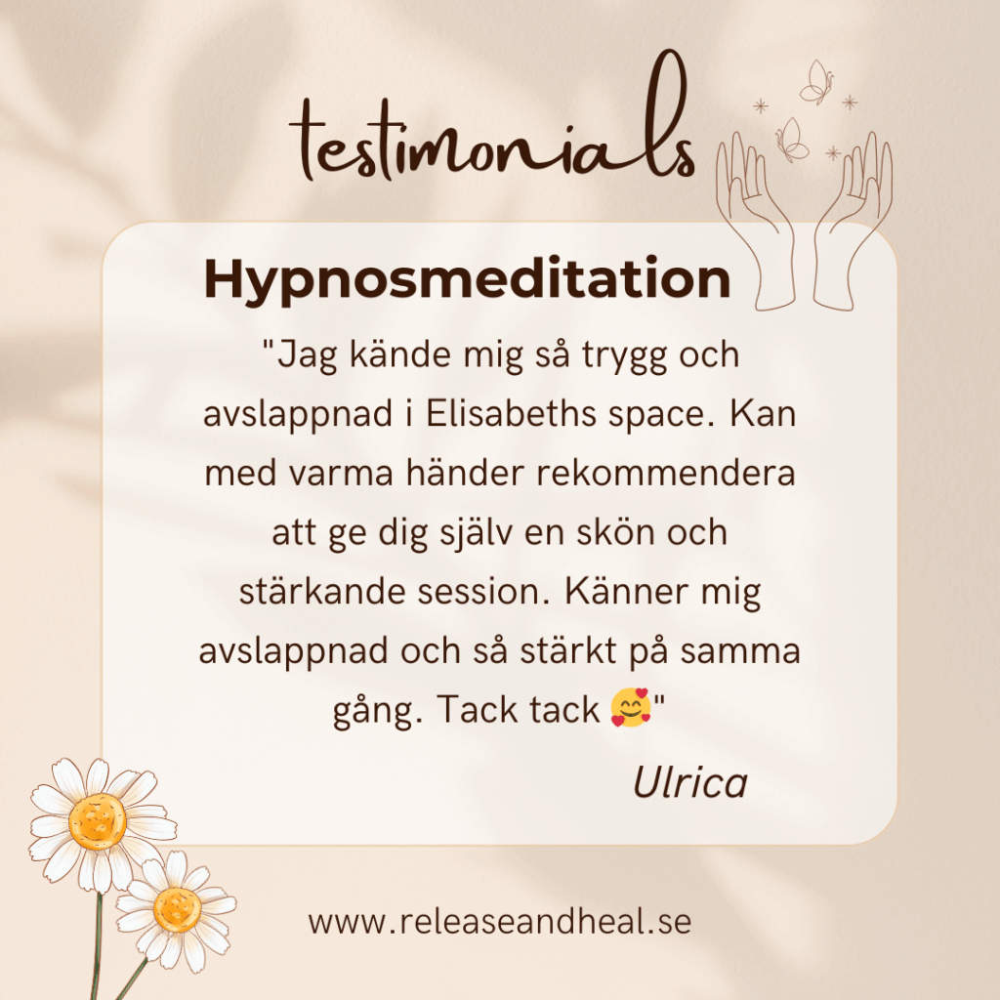
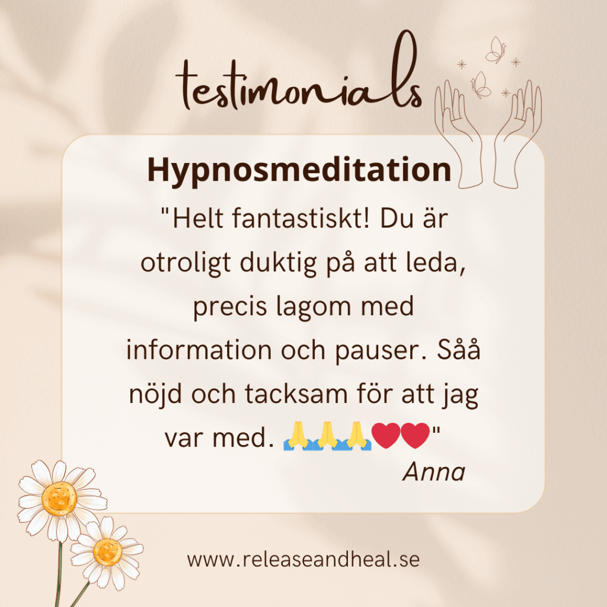

<h2>Välkommen till Release & Heal</h2>

Så fint att du hittat hit! Jag som driver Release & Heal heter Elisabeth Rietz och jag är coach, terapeut, healer & medium. Här erbjuds du:

<ul style="margin: 1em 0 2em 0; padding-left: 1.2em; color: #7c5c3e; font-size: 1.1em; line-height: 2.2em;">
  <li>Hypnoterapi</li>
  <li>NLP-coaching</li>
  <li>Medial vägledning</li>
  <li>Healing med Reiki & Emotion code</li>
  <li>Livscoaching</li>
  <li>Helande samtal</li>
  <li>Återhämtningsterapi</li>
  <li>Mindfulness</li>
  <li>Meditation</li>
  <li>Personlig och andlig utveckling</li>
  <li>Reikikurser (kommande)</li>
</ul>

  
  

    
Jag ser holistiskt på människan och hälsan. Allt hänger samman – det mentala, fysiska, emotionella och andliga. Du får stöd och vägledning med metoder som hjälper dig med stress, utmattning, självkänsla, medberoende och ohjälpsamma mönster. Vill du kan du även få medial vägledning för att hitta din livsväg och lära känna dig själv på djupet.

    
Jag skräddarsyr hjälpen efter dina behov och arbetar främst online, men kan även erbjuda sessioner i Veberöd.

    
Min drivkraft är att vara en katalysator för transformation – att hjälpa dig finna kärleken till dig själv och växa som människa.

    
<strong>Varmt välkommen!</strong>

  

<h2>Så går det till</h2>

<ol class="steps">
  <li><strong>Utforskande samtal</strong>30 minuter, gratis. Du berättar vad du önskar hjälp med och jag lyssnar in hur jag bäst kan hjälpa dig.</li>
  <li><strong>Första sessionen</strong>Vi bokar in den utifrån dina behov, på distans eller i Veberöd.</li>
  <li><strong>Fortsättning</strong>Antal sessioner varierar beroende på vad vi arbetar med.</li>
</ol>

<h2>Boka tid / Kontakt</h2>

Fyll i formuläret nedan för att boka tid eller kontakta mig.

<form data-offer-form action="https://formspree.io/f/xwpnrgzn" method="POST" style="max-width:400px;margin:0 auto 2em auto;display:flex;flex-direction:column;gap:16px;">
  

    <strong>✓ Mässerbjudande aktiverat</strong>
  

  <input type="hidden" name="Mässerbjudande" value="Nej" disabled>
  <input type="hidden" name="_subject" value="Bokningsförfrågan från hemsidan">
  <select name="Tjänst" id="service-field" required style="padding:12px;border-radius:6px;border:1px solid #f6d2a5;background:#fff;color:#7c5c3e;">
    
  </select>
  <input type="text" name="Namn" placeholder="Namn" required style="padding:12px;border-radius:6px;border:1px solid #f6d2a5;">
  <input type="email" name="E-post" placeholder="E-post" required style="padding:12px;border-radius:6px;border:1px solid #f6d2a5;">
  <textarea name="Meddelande" placeholder="Meddelande" required style="padding:12px;border-radius:6px;border:1px solid #f6d2a5;min-height:100px;"></textarea>
  <button type="submit" class="cta" style="width:100%;font-size:1.1em;">Skicka bokningsförfrågan</button>
</form>

  

<h2>Omdömen</h2>

  

    
    
    
    
    
    
    
    
  

  <button class="carousel-btn prev" aria-label="Föregående omdöme">&#10094;</button>
  <button class="carousel-btn next" aria-label="Nästa omdöme">&#10095;</button>
  

---

<blockquote>"Släpp taget om det gamla och ge plats för det nya. Release & Heal hjälper dig på din resa!"</blockquote>

